<div align="center">
  <a href="https://v2.nonebot.dev/store"></a>
  <br>
  <p></p>
</div>

<div align="center">

# nonebot-plugin-cp-broadcast

_✨ 一个 Codeforces、牛客竞赛、AtCoder 平台的编程竞赛查询插件，ACMer必备 ✨_


<a href="./LICENSE">
    
</a>
<a href="https://pypi.python.org/pypi/nonebot-plugin-cp-broadcast">
    
</a>


</div>

## 📖 介绍

对于每一个 ACMer 来说，参加编程竞赛是必不可少的，这个插件实现了 Codeforces、牛客竞赛、AtCoder 这三个主流的编程竞赛平台的比赛查询和播报。

除了简单的指令外，它支持每天定时发送三种比赛的信息。

比赛查询结果会缓存在内存列表中，以减少重复访问比赛网站的次数。

· Codeforces:
极负盛名的俄罗斯算法竞赛练习网站。相关的比赛播报乃至用户监视提醒功能均由Codeforces官方提供的api实现。当然由于是国外网站，在国内访问可能会比较缓慢。

· 牛客竞赛:
国内比较出名的找工作乃至练习算法的竞赛平台。比赛信息的获取是通过对网页爬取分析得到的。目前没开发出牛客竞赛的用户监视功能。

· AtCoder:
日本出名的算法竞赛平台。比赛信息的获取是通过对网页爬取分析得到的。目前没开发出AtCoder的用户监视功能。

为什么取 cp-broadcast 这个英文名呢？因为竞赛性编程的英文是：Competitive Programming，直接拿来做名字感觉太长了，因此我把它写成了缩写，broadcast 是播报的意思，因此就用 cp-broadcast 来当名字了。

插件可能有很多不完善的地方，欢迎大家来提 issue 和 pull requests。 

有任何问题可联系QQ：3411907440。

## 💿 安装

<details>
<summary>使用 nb-cli 安装</summary>
在 nonebot2 项目的根目录下打开命令行, 输入以下指令即可安装

    nb plugin install nonebot-plugin-cp-broadcast

</details>

<details>
<summary>使用包管理器安装</summary>
在 nonebot2 项目的插件目录下, 打开命令行, 根据你使用的包管理器, 输入相应的安装命令

<details>
<summary>pip</summary>

    pip install nonebot-plugin-cp-broadcast
</details>
<details>
<summary>pdm</summary>

    pdm add nonebot-plugin-cp-broadcast
</details>
<details>
<summary>poetry</summary>

    poetry add nonebot-plugin-cp-broadcast
</details>
<details>
<summary>conda</summary>

    conda install nonebot-plugin-cp-broadcast
</details>

打开 nonebot2 项目根目录下的 `pyproject.toml` 文件, 在 `[tool.nonebot]` 部分追加写入

    plugins = ["nonebot_plugin_cp_broadcast"]

</details>

## ⚙️ 配置

在 nonebot2 项目的`.env`文件中添加下表中的必填配置

|           配置项            | 必填 |                     默认值                     |                                      说明                                      |
|:------------------------:|:----:|:-------------------------------------------:|:----------------------------------------------------------------------------:|
|    cp_broadcast_path     | 否 | get_data_dir("nonebot_plugin_cp_broadcast") | 数据存储目录，用户不定义则由 localstore 插件确定；Codeforces 监视数据写入此目录下的 `data.json` |
|    cp_broadcast_list     | 否 |                     [ ]                     |                      开启早晨自动播报今日比赛的群聊，填 QQ 群号，注意以字符串形式填入                      |
|   cp_broadcast_botname   | 否 |                    "bot"                    |                    填入你 bot 的名字，在 `help` 指令下会使用到你的 bot 的名字                    |
|    cp_broadcast_time     | 否 |         {"hour":"7", "minute":"20"}         |             每日在群聊播报比赛信息的时间，默认是早上 7 点 20，你可以在配置文件中按默认值格式修改成你想要的时间             |
| cp_broadcast_updatetime  | 否 |         {"hour":"0", "minute":"0"}          |              每天自动更新比赛数据的时间，默认是 0 点 0 分，你可以在配置文件中按默认值格式修改成你想要的时间              |
|   cp_broadcast_cf_list   | 否 |                     [ ]                     |                   开启 Codeforces 播报功能的群聊，cf监视的相关功能只在指定群聊里发送                   |
| cp_broadcast_cf_interval | 否 |                     10                      | 更新 Codeforces 监视信息的时间间隙，默认为 10 分钟（不建议设置太短，可能会对服务器造成比较大的压力。另外监视人数多的话间隙尽量加长一点） |

就像这样：
```
cp_broadcast_path="data/cp_broadcast"
cp_broadcast_list=["xxxxxxxx"]
cp_broadcast_botname="bot"
cp_broadcast_time={"hour":"7", "minute":"20"}
cp_broadcast_updatetime={"hour":"0", "minute":"0"}
cp_broadcast_cf_list=["xxxxxxxx"]
cp_broadcast_cf_interval=10
```

Codeforces 的用户资料、监视备注、提醒状态和 rating 历史都保存在 `cp_broadcast_path/data.json` 中。本版本不读取旧版 SQLite 数据；升级后请对每个需要监视的用户逐个发送 `cf监视 <handle>`。文件大致采用下面的结构，用户以小写 handle 为键，rating 历史以 contest ID 为键。每次成功获取 API 历史后会整体替换已有内容，并只保留更新时间最新的 5 场（可以少于 5 场）；API 请求失败时保留上次成功获取的内容：

```json
{
  "version": 1,
  "users": {
    "example_handle": {
      "profile": {
        "handle": "example_handle",
        "rating": 1600,
        "rank": "expert"
      },
      "monitor": {
        "remarks": "示例备注",
        "last_processed_submission_id": 123456789,
        "last_submission_event_at_seconds": 1780000000,
        "last_notified_submission_id": 123456789,
        "delivery_attempts": {
          "123456789": {
            "submission_id": 123456789,
            "submission_attempt_at_seconds": 1780000000
          }
        }
      },
      "rating_history": {
        "2000": {
          "contest_id": 2000,
          "contest_name": "Example Contest",
          "rank": 1,
          "old_rating": 1500,
          "new_rating": 1600,
          "rating_update_time_seconds": 1760000000
        }
      }
    }
  }
}
```

示例只展示主要字段；实际文件还会包含可用的其他用户资料和通知游标。字段说明见[JSON 数据结构说明](./docs/database-design.md)。

Codeforces 做题监视每隔 `cp_broadcast_cf_interval` 分钟查询最新提交，只比较最新提交 ID 是否与上次保存的 ID 不同。添加用户时先建立基线，避免提醒历史提交；请求失败后第一次成功查询也只建立基线。每次发现不同的提交 ID，都在该轮查询中先更新并保存 `last_processed_submission_id`，再返回播报事件，因此相同提交不会因为消息发送失败而在下一轮再次判为新提交。两小时冷却期从生成事件时开始，也独立于发送结果；冷却期内的新提交只更新记录，不生成事件。提醒展示提交 ID 和实际提交时间。

为避免重复刷屏，每条通知按“群号＋用户＋提交 ID”在 `delivery_attempts` 中先保存发送预留，再调用机器人发送。最新提交 ID 保持不变时，同一群不会重复尝试发送；同一用户在同一群的提交提醒有 2 小时冷却期，期间检测到的新提交会跳过，之后不会补发。去重记录写入失败时停止该条发送；发送失败、超时或重启后不自动重发已预留的通知。这样可能漏掉一条提醒，但能避免因发送结果不明而循环刷屏。各群独立处理，rating 提醒也按群保存去重水位。

`delivery_attempts` 以群号为键，每个群只保存最新提交 ID、尝试时间和 rating 水位，不逐条追加通知历史。数据目录下的 `.cp-broadcast.lock` 用于阻止多个进程同时使用同一份数据，业务数据仍全部保存在 `data.json`。

插件内的 Codeforces API 请求共用限速锁，请求开始时间至少间隔 2.1 秒，以满足[官方每 2 秒最多一次请求的限制](https://codeforces.com/apiHelp)。监视人数较多时，一轮查询需要更长时间，请适当增加轮询间隔。

该插件依赖 [nonebot_plugin_apscheduler](https://github.com/nonebot/plugin-apscheduler) 实现定时发送功能，如果你未安装此依赖的话，将无法触发与定时相关的功能。

若旧版本正在重复播报，可先设置 `cp_broadcast_cf_list=[]` 并重启机器人停止监视通知。替换实际运行环境加载的插件代码后，确认启动日志出现“已启用按群持久化去重（发送前预留，失败不自动重发）”，再恢复群列表。当前代码的消息含提交 ID；如果仍出现“卷王……又开始上cf做题啦”，请检查旧机器人进程或其他安装目录是否仍在运行。

## 🎉 使用
### 指令表
|      指令      | 权限 | 需要@ | 范围 |             说明              |
|:------------:|:----:|:----:|:----:|:---------------------------:|
|     `cf`     | 群员 | 否 | 群聊 |   发送最近三场 Codeforces 比赛的信息   |
| `牛客` or `nc` | 群员 | 否 | 群聊 |        发送最近三场牛客比赛的信息        |
|    `atc`     | 群员 | 否 | 群聊 |    发送最近两场 AtCoder 比赛的信息     |
|   `today`    | 群员 | 否 | 群聊 |          发送今天的比赛信息          |
|    `next`    | 群员 | 否 | 群聊 |        发送今天后的部分比赛信息         |
|    `help`    | 群员 | 是 | 群聊 |           发送帮助信息            |
|   `update`   | 群员 | 否 | 群聊 |          手动更新比赛信息           |
|    `cf监视`    | 群员 | 是 | 群聊 |       监视某人的 rating 变化和新提交       |
|   `cf监视移除`   | 群员 | 是 | 群聊 |      移除某人的监视      |
|   `cf监视列表`   | 群员 | 是 | 群聊 |         展示已经监视了哪些人          |
|    `cf查询`    | 群员 | 是 | 群聊 |        查询对应 id 的相关信息        |
|    `cf排名`    | 群员 | 是 | 群聊 |      查询当前监视列表的rating排名      |
|   `cf监视备注`   | 群员 | 是 | 群聊 | 给某个已经被监视的人备注一个名字，两字符串之间用空格隔开 |


### 效果图

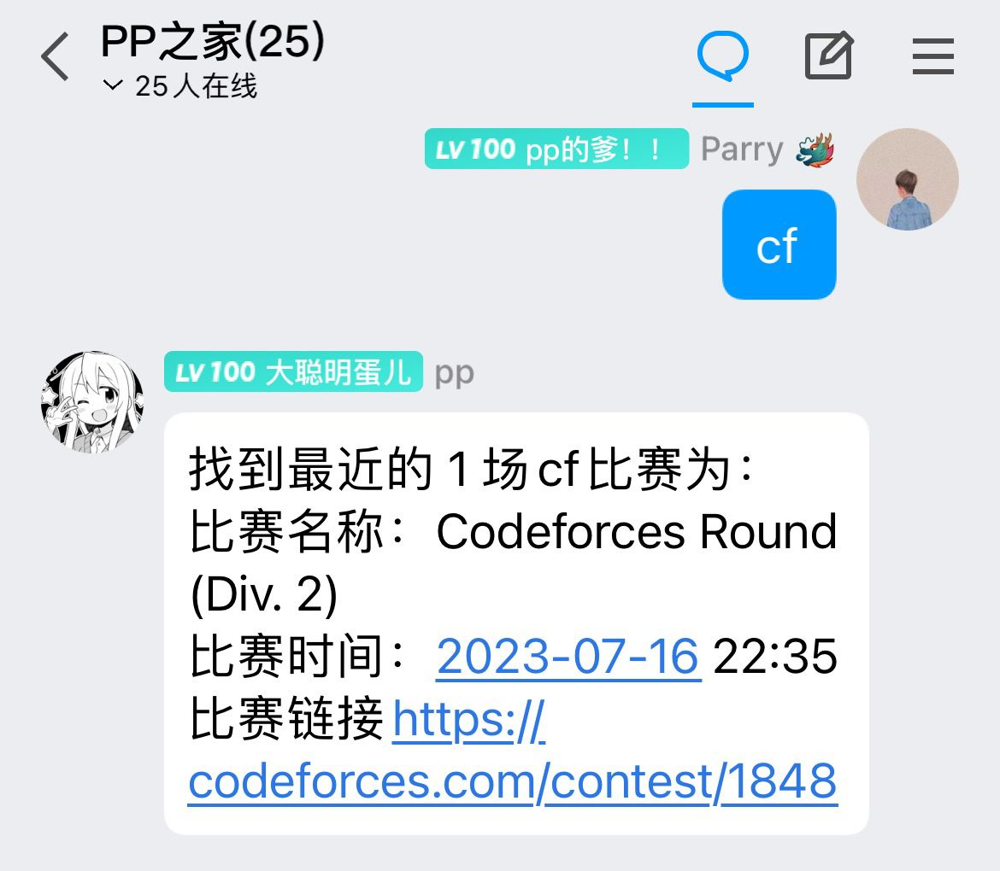

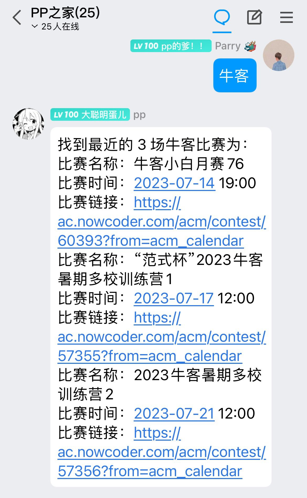

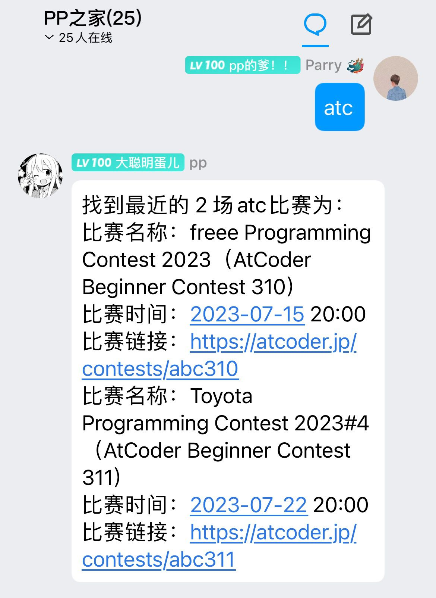

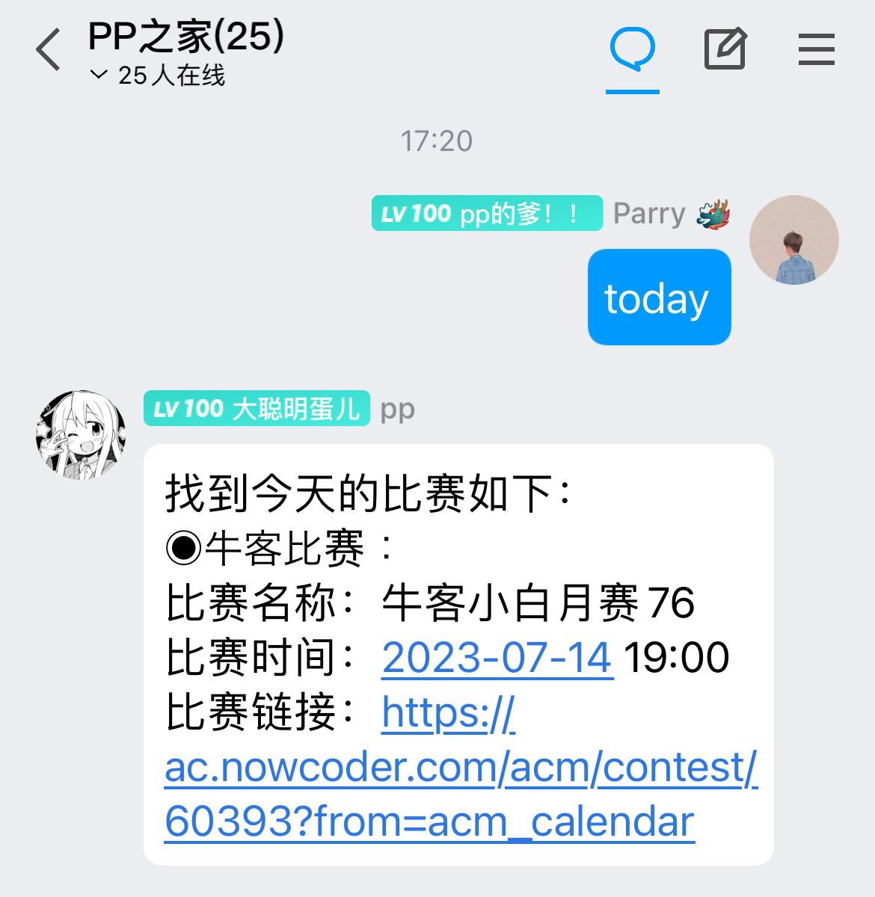

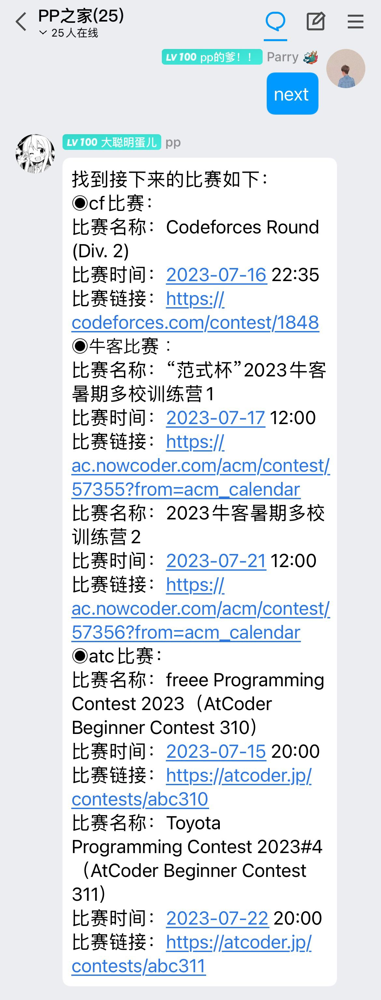

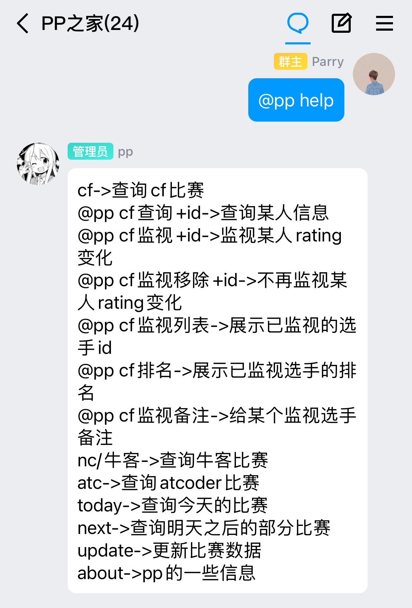

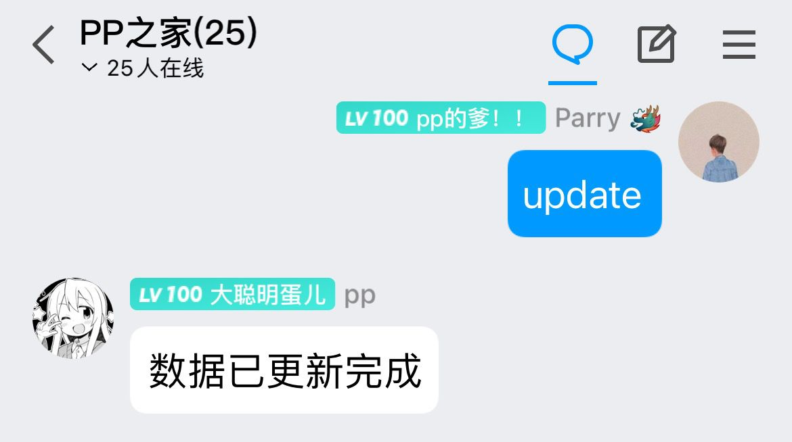

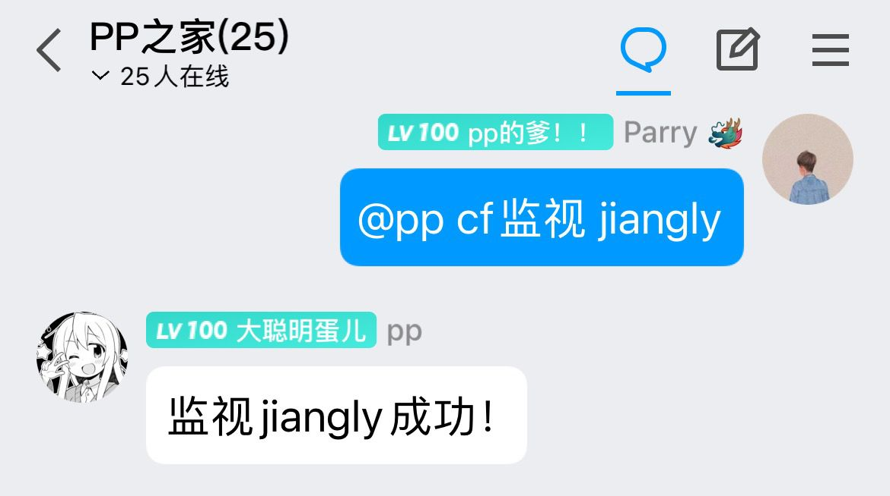

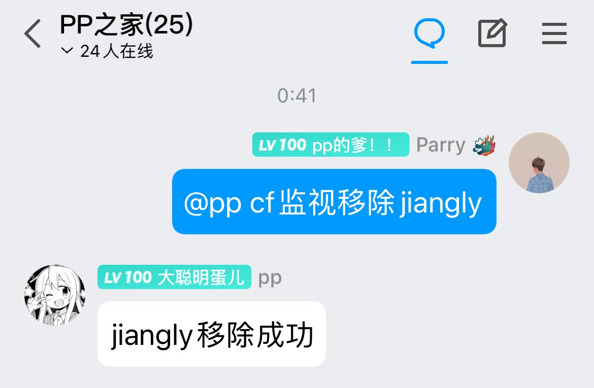

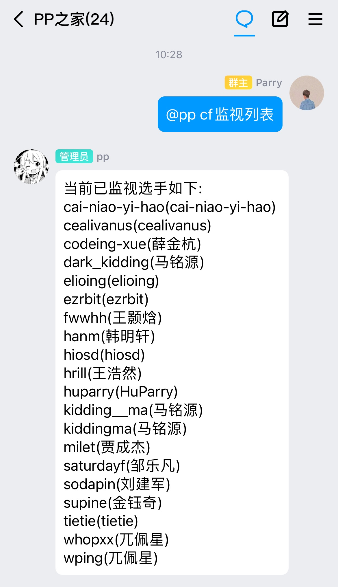

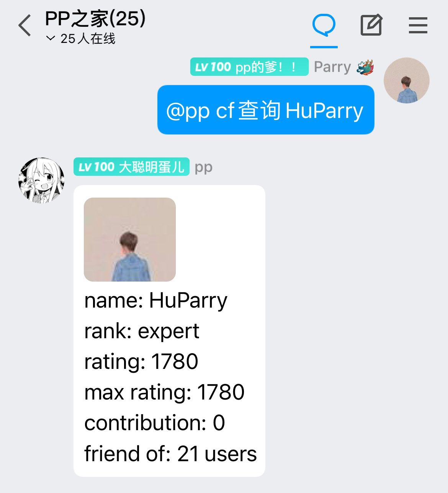

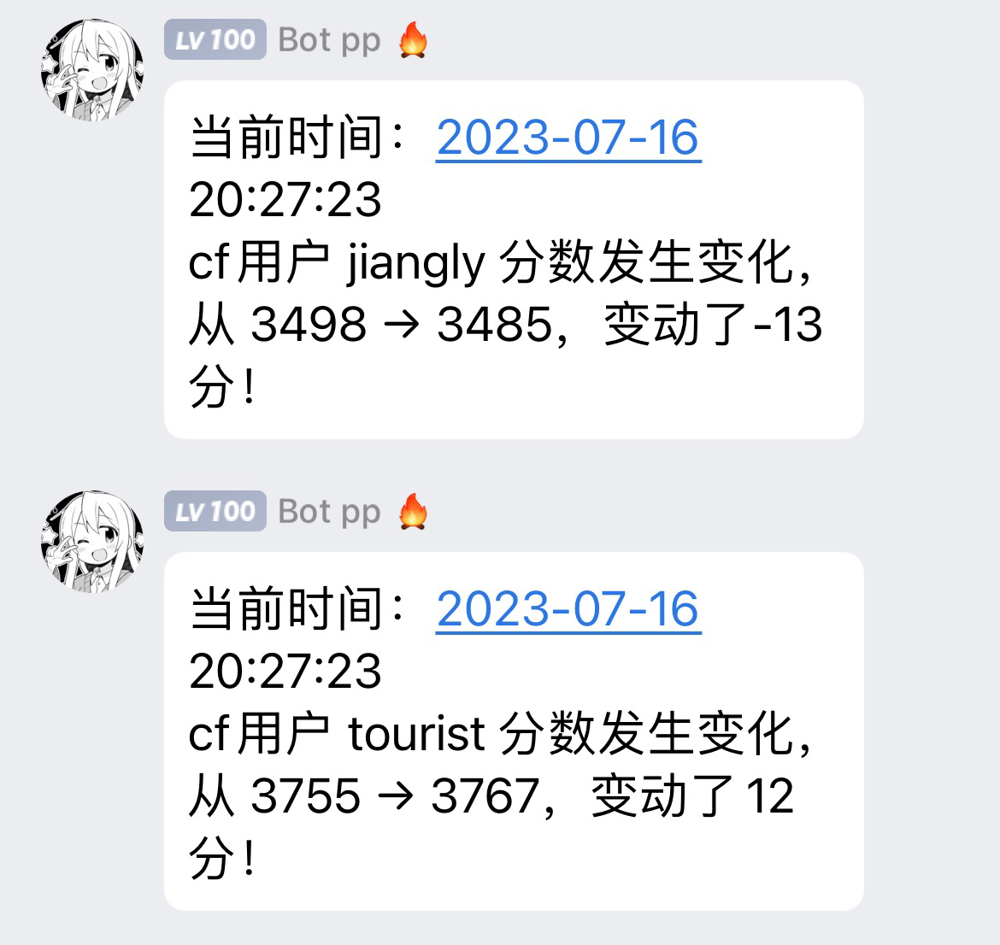

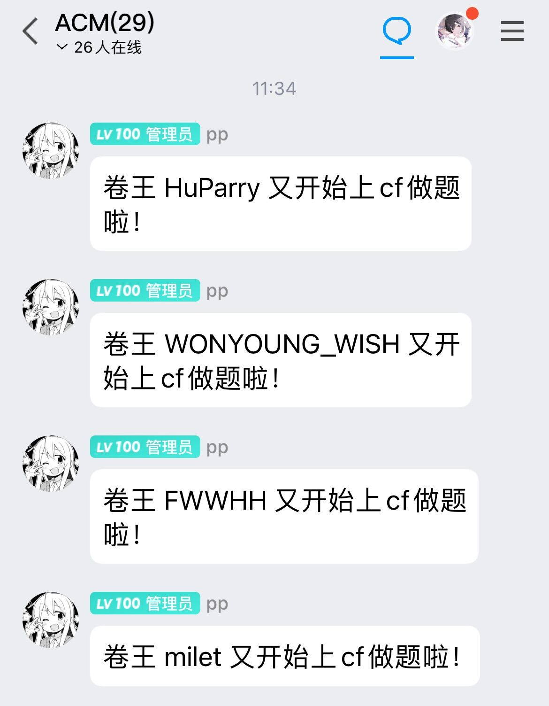

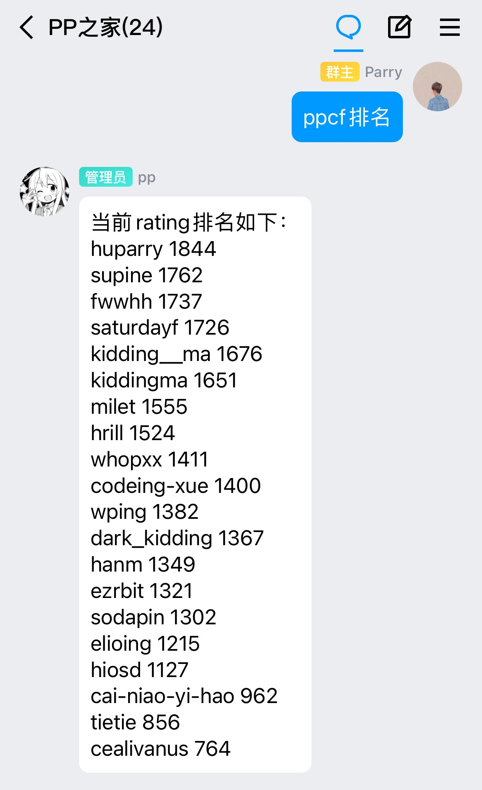

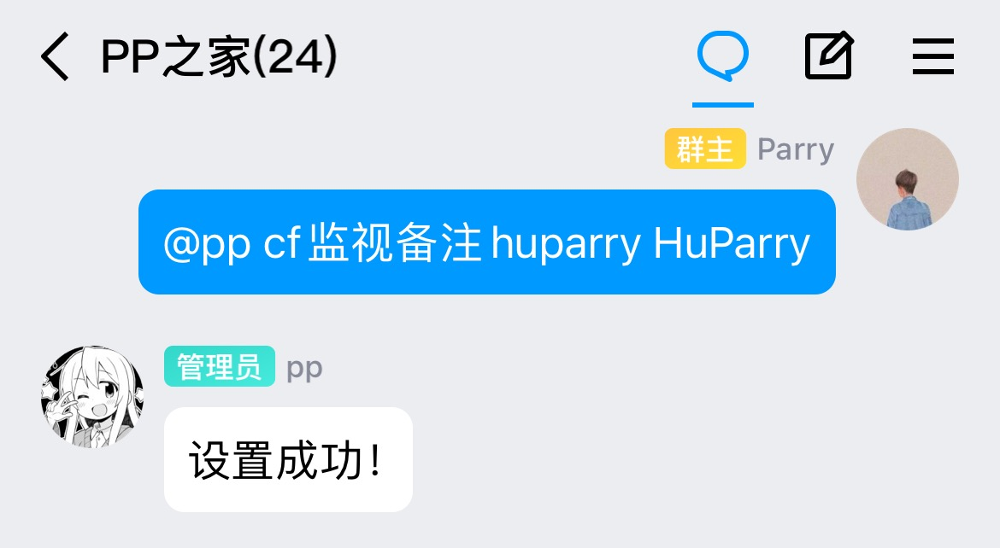

## 鸣谢
感谢以下开发者作出的贡献：

<a href="https://github.com/HuParry/nonebot-plugin-cp-broadcast/graphs/contributors">
  
</a>
